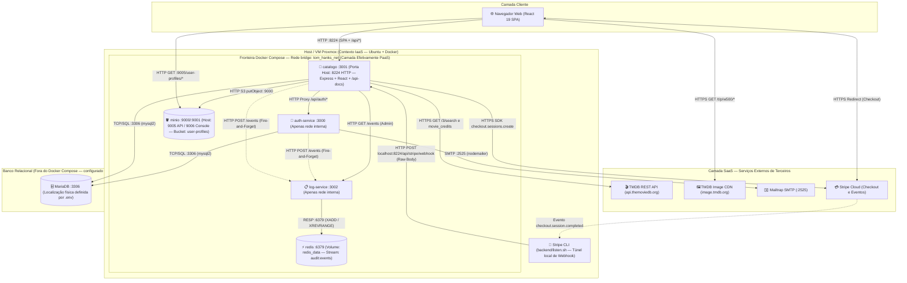
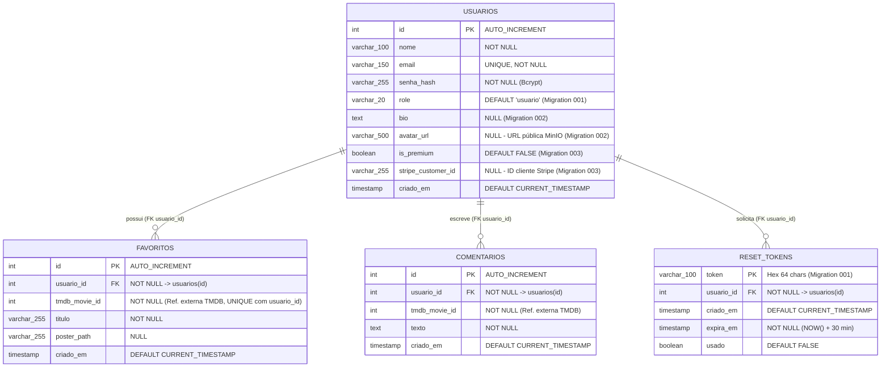

# 📘 Documentação Reversa — Catálogo de Filmes Tom Hanks

> **Documento de Engenharia Reversa (Atividade 8 — ISW055)**  
> **Professor:** Allan Siriani ([@siriani](https://github.com/siriani))  
> **Data da Inspeção do Código:** 23/10/2026  
> **Escopo:** Levantamento completo da especificação funcional, arquitetura distribuída ("Big Picture"), regras de negócio implementadas no código (*"Se X, então Y"*) e modelo de dados poliglota do sistema herdado.  
> 🔗 Voltar para o [**README Principal (Classificação SaaS/PaaS/IaaS e Histórico)**](README.md)

---

## 📑 Sumário

1. [Fontes de Evidência e Metodologia](#0-fontes-de-evidência-e-metodologia)
2. [Especificação Funcional do Sistema (Requisito 2)](#1-especificação-funcional-do-sistema-requisito-2)
3. [Arquitetura do Sistema — "Big Picture" (Requisito 3)](#2-arquitetura-do-sistema--big-picture-requisito-3)
4. [Regras de Negócio Extraídas do Código — "Se X, então Y" (Requisito 4)](#3-regras-de-negócio-extraídas-do-código--se-x-então-y-requisito-4)
5. [Modelo de Dados (Requisito 5)](#4-modelo-de-dados-requisito-5)

---

## 0. Fontes de Evidência e Metodologia

Esta documentação foi construída por **inspeção estática direta do código-fonte** existente no repositório, escrita sob a perspectiva de um engenheiro que acabou de herdar o sistema e precisa registrar exatamente o que ele faz hoje — incluindo suas limitações reais — antes de realizar qualquer manutenção futura.

Para distinguir fatos comprovados em código de premissas de ambiente, adotamos três marcadores ao longo do documento:
- **`[Código / Compose]`**: Comprovado diretamente nos arquivos `.ts`, `.tsx`, `Dockerfile`, `openapi.yaml` e `docker-compose.yml`.
- **`[Histórico / README / Migrations]`**: Extraído do DDL documentado no `README.md` e dos scripts incrementais em `migrations/`.
- **`[Contexto do Enunciado]`**: Premissa operacional da disciplina (ex.: execução sobre VM Proxmox da Fatec).

---

## 1. Especificação Funcional do Sistema (Requisito 2)

Do ponto de vista de quem utiliza e administra a plataforma, o **Catálogo Tom Hanks** é uma aplicação web multiusuário que combina consulta em tempo real à filmografia do ator Tom Hanks com recursos de rede social (favoritos, comentários, perfil com foto e biografia), monetização via assinatura Premium e trilha de auditoria para administradores.

### 1.1. Visão Geral das Funcionalidades por Perfil de Uso

| Módulo | O que o sistema faz hoje | Interface Disponível | Quem pode usar |
| ------ | ------------------------ | -------------------- | -------------- |
| **Cadastro e Login** | Cria conta com nome, e-mail e senha; autentica o usuário retornando um token JWT válido por 24 horas. | Tela React (`/`) + API (`/api/auth/register`, `/api/auth/login`) | Público (Anônimo) |
| **Recuperação de Senha** | Envia por e-mail (via Mailtrap SMTP) um link com token temporário de 30 minutos para redefinir a senha. | Telas React (`/forgot-password`, `/reset-password`) + API | Público (Anônimo) |
| **Catálogo de Filmes** | Lista a filmografia do Tom Hanks buscada em tempo real na API do TMDB (`pt-BR`), com filtro instantâneo por título no navegador. | Tela React (`/catalog`) + API (`GET /api/movies/tom-hanks`) | Usuário autenticado (`usuario` ou `admin`) |
| **Favoritos** | Permite favoritar e desfavoritar filmes com atualização visual instantânea (*Optimistic UI*), mantendo a lista isolada por usuário. | Tela React (`/catalog`, `/profile`) + API (`/api/movies/favorites`) | Usuário autenticado (`usuario` ou `admin`) |
| **Comentários e Moderação** | Permite adicionar comentários em filmes, listar os próprios comentários no modal do filme e apagar comentários (próprios ou, no caso de `admin`, de qualquer usuário). | Modal React em `/catalog` (criação e leitura) + API (`DELETE /api/movies/comments/:commentId`) | Criação/Leitura: autenticado; Exclusão de terceiros: exclusivo `admin` |
| **Perfil e Avatar** | Exibe nome, e-mail, selo Premium, biografia editável, foto de perfil (armazenada em bucket público do MinIO) e grade de filmes favoritos. | Tela React (`/profile`) + API (`/api/profile`, `/api/profile/avatar`) | Usuário autenticado (edita apenas o próprio perfil) |
| **Plano Premium (Stripe)** | Redireciona o usuário não-premium para o Checkout hospedado pelo Stripe; após confirmação via Webhook, promove a conta para `is_premium = true` e exibe o selo `🌟 Premium` no perfil. | Botão em `/profile` + Telas `/success` e `/cancel` + API (`/api/stripe/*`) | Usuário autenticado |
| **Logs de Auditoria** | Dispara o envio assíncrono (*best-effort*) de eventos de negócio e tentativas de acesso negado (`401`/`403`) ao `log-service` (Redis Streams) e permite consultar os últimos $N$ eventos persistidos. | **Apenas API / Swagger** (`GET /api/admin/logs`) — *não possui tela no React* | Exclusivo `admin` |

### 1.2. Detalhamento dos Fluxos sob a Ótica do Usuário

1. **Cadastro, Login e Logout (`/`, `/forgot-password`, `/reset-password`):**
   - Na tela inicial (`frontend/src/pages/Login.tsx`), o visitante alterna entre entrar com e-mail/senha ou criar uma nova conta. Todo novo cadastro recebe automaticamente o papel `usuario`.
   - Ao fazer login, o frontend armazena o `token` JWT e os dados básicos do usuário no `localStorage` e redireciona para `/catalog`.
   - Caso esqueça a senha, o usuário informa seu e-mail em `/forgot-password`. Se o e-mail estiver cadastrado, o `auth-service` dispara uma mensagem SMTP para o Mailtrap contendo um link para `http://localhost:8224/reset-password?token=...`.
   - Ao clicar em **Sair** no cabeçalho do catálogo (`Catalog.tsx:69-78`), o frontend chama `POST /api/auth/logout` (que apenas dispara o envio de um evento de auditoria), limpa o `localStorage` do navegador e retorna à tela de login. Como o JWT é *stateless* e não há *blocklist* no servidor, nem o logout nem a redefinição de senha invalidam tokens JWT já emitidos antes de sua expiração de 24 horas.

2. **Navegação no Catálogo e Favoritos (`/catalog`):**
   - Ao abrir o catálogo, a aplicação carrega em paralelo a filmografia do Tom Hanks (`GET /api/movies/tom-hanks`) e a lista de favoritos do usuário logado (`GET /api/movies/favorites`).
   - Os pôsteres são carregados pelo navegador diretamente da CDN pública do TMDB (`https://image.tmdb.org/t/p/w500/...`).
   - O botão **Favoritar / Desfavoritar** aplica *Optimistic UI* (`Catalog.tsx:41-67`): o estado visual muda imediatamente no clique e, caso a requisição HTTP (`POST` ou `DELETE`) falhe no servidor, o estado anterior é restaurado na tela.

3. **Comentários e Moderação RBAC (`/catalog` e API):**
   - Clicar em **Detalhes** em qualquer card abre um modal com a sinopse (`overview`) do filme e a seção de comentários.
   - *Observação de engenharia reversa sobre leitura de comentários:* A rota `GET /api/movies/comments/:movieId` (`backend/src/routes/movies.ts:140-143`) filtra os comentários por `WHERE usuario_id = ? AND tmdb_movie_id = ?`. Isso significa que, na interface atual, cada usuário visualiza no modal apenas os comentários feitos por ele mesmo naquele filme.
   - *Observação sobre exclusão e moderação:* O endpoint `DELETE /api/movies/comments/:commentId` permite que o dono apague seu próprio comentário ou que um `admin` apague o comentário de qualquer usuário (registrando `moderacao: true` na auditoria). No código atual do frontend (`Catalog.tsx`), não há botão de exclusão de comentário renderizado no modal, sendo a exclusão/moderação acionada diretamente via API ou Swagger (`/api-docs`).

4. **Perfil do Usuário e Upload de Avatar (`/profile`):**
   - A página **Meu Perfil** (`frontend/src/pages/Profile.tsx`) exibe o avatar atual (ou a inicial do nome quando não há foto), nome, e-mail, biografia e a grade de filmes favoritados.
   - O usuário pode editar e salvar sua biografia (`PUT /api/profile`) e enviar uma nova foto de perfil (`POST /api/profile/avatar`) de até **5 MB** (`image/*`). A imagem é gravada no **MinIO** e sua URL é salva no banco com o host fixo `http://localhost:9005/user-profiles/...` (o que significa que o navegador tenta buscar a imagem na própria máquina onde está aberto, funcionando em acesso local, mas falhando caso outro computador na rede acesse a aplicação).

5. **Assinatura do Plano Premium (`/profile`, `/success`, `/cancel`):**
   - Usuários que ainda possuem `is_premium = false` veem o botão **✨ Assinar Premium** no perfil.
   - Ao clicar, o backend cria uma `Checkout Session` no Stripe (`POST /api/stripe/checkout`) e devolve a URL externa do Stripe Checkout.
   - Após o pagamento no ambiente do Stripe, o usuário é redirecionado para `/success` (ou `/cancel` se desistir), enquanto o Stripe notifica assincronamente o backend em `POST /api/stripe/webhook`. Confirmado o evento `checkout.session.completed`, o banco atualiza `is_premium = true` e o perfil passa a exibir o selo dourado **🌟 Premium** ao lado do nome.

6. **Auditoria para Administradores (`GET /api/admin/logs`):**
   - Ações de autenticação, criação/remoção de favoritos, criação/exclusão de comentários, consultas de logs e tentativas de acesso negado (`401`/`403` nas rotas cobertas pelo interceptor) disparam um envio assíncrono (*fire-and-forget*) para o `log-service`, que quando disponível persiste os eventos no Redis Streams (`audit:events`).
   - Administradores (`role = 'admin'`) consultam os últimos $N$ eventos (padrão `50`, máximo `500`) pelo endpoint `GET /api/admin/logs` (via Swagger UI em `http://localhost:8224/api-docs` ou cliente HTTP). Não há tela administrativa de logs no React.
   - Além disso, o `auth-service` possui internamente a rota `GET /auth/verify` (`authRoutes.ts:13`), sem proxy correspondente no `catalogo` e sem uso pelo frontend atual.

---

## 2. Arquitetura do Sistema — "Big Picture" (Requisito 3)

O sistema final adota uma arquitetura de microsserviços orquestrada via **Docker Compose** sobre uma rede bridge isolada (`tom_hanks_net`), na qual o serviço **`catalogo`** atua simultaneamente como servidor de arquivos estáticos do frontend React, API de negócio e **API Gateway / Proxy Reverso** para os microsserviços internos (`auth-service` e `log-service`).

### 2.1. Diagrama Geral da Arquitetura

### 2.2. Inventário de Componentes, Portas e Conexões (`[Código / Compose]`)

| Componente | Container / Host | Portas (Host $\rightarrow$ Container) | Visibilidade de Rede | Responsabilidade e Conexões |
| ---------- | ---------------- | ------------------------------------- | -------------------- | --------------------------- |
| **`catalogo`** (`backend/` + `frontend/dist`) | `catalogo_tom_hanks` | **`8224:3001`** (`HTTP`, sem TLS) | Pública (Host) + `tom_hanks_net` | Porta única de entrada da aplicação. Serve o React compilado, a documentação Swagger (`/api-docs`, definida em `backend/src/server.ts:36`) e os endpoints `/api/*`. Faz proxy HTTP de `/api/auth/*` para `auth-service:3000`, consulta o TMDB, faz upload S3 ao MinIO, inicia sessões Stripe, recebe o webhook e consulta/emite eventos ao `log-service:3002`. |
| **`auth-service`** (`auth-service/`) | `auth_tom_hanks` | Sem porta no host (`:3000` interno) | Exclusiva `tom_hanks_net` | Gerencia registro, login (emissão de JWT com `id`, `email`, `role`), esqueci a senha (envio SMTP via Mailtrap) e redefinição de senha no MariaDB. Emite eventos de auditoria para `log-service:3002`. Possui Swagger interno em `:3000/api-docs`. |
| **`log-service`** (`log-service/`) | `log_tom_hanks` | Sem porta no host (`:3002` interno) | Exclusiva `tom_hanks_net` | Microsserviço de auditoria. Recebe `POST /events` e responde `GET /events` exigindo o cabeçalho `X-Internal-Token` (`internalAuth.ts`). Expõe `GET /health` sem autenticação para healthcheck do Docker. |
| **`redis`** (`redis:7-alpine`) | `redis_tom_hanks` | Sem porta no host (`:6379` interno) | Exclusiva `tom_hanks_net` | Armazena o Redis Stream `audit:events` com persistência AOF (`--appendonly yes`), autenticação por senha (`REDIS_PASSWORD`) e volume `redis_data`. |
| **`minio`** (`elestio/minio:latest`) | `minio_tom_hanks` | **`9005:9000`** (API S3) **`9006:9001`** (Console) | Pública (Host) + `tom_hanks_net` | Object Storage compatível com Amazon S3. Recebe uploads de avatares via rede interna (`minio:9000`) a partir do `catalogo` e entrega as imagens diretamente ao navegador via `http://localhost:9005/user-profiles/...`. Persiste dados no volume `minio_data`. |
| **`MariaDB`** (Externo ao Compose) | Configurado via `DB_HOST` | `:3306` (`TCP/SQL`) | Rede externa alcançável pelos containers | Banco relacional compartilhado entre `catalogo` e `auth-service` via pool de conexões `mysql2/promise`. Não está declarado no `docker-compose.yml` (sua localização física depende do `.env` do ambiente). |
| **`Stripe` + `Stripe CLI`** | Nuvem externa + script `backend/listen.sh` | `HTTPS` (API) / Túnel local $\rightarrow$ `:8224` | Internet $\leftrightarrow$ Host | O `catalogo` cria sessões de checkout na nuvem do Stripe. Para que o webhook `POST /api/stripe/webhook` chegue ao container em ambiente de desenvolvimento/teste sem domínio público, o script `backend/listen.sh` executa `stripe listen --forward-to localhost:8224/api/stripe/webhook`. |
| **`Mailtrap` e `TMDB`** | Nuvem externa | `:2525` (`SMTP`) / `:443` (`HTTPS`) | Internet | `Mailtrap` recebe os e-mails transacionais de recuperação de senha disparados pelo `auth-service`; `TMDB` fornece os dados de filmes ao `catalogo` e os pôsteres diretamente ao navegador. |

---

## 3. Regras de Negócio Extraídas do Código — "Se X, então Y" (Requisito 4)

As regras abaixo foram extraídas diretamente da leitura dos arquivos `.ts` e `.tsx` do projeto, sem depender da memória. Onde a implementação atual possui comportamentos parciais ou limitações, estes estão explicitamente documentados.

### 3.1. Autenticação, Cadastro e Recuperação de Senha

1. **Bloqueio de E-mail Duplicado (`auth-service/src/controllers/authController.ts:19-23`):**  
   **Se** alguém tentar cadastrar (`POST /api/auth/register`) um `email` que já existe na tabela `usuarios`, **então** o sistema interrompe o cadastro e retorna `HTTP 400` com `{"error": "Email já cadastrado"}`.

2. **Hash de Senha e Papel Inicial Fixo (`auth-service/src/controllers/authController.ts:25-37`):**  
   **Se** os dados de registro forem aceitos, **então** a senha é transformada em hash pelo `bcrypt` com `saltRounds = 10`, o usuário é salvo no banco com o papel padrão `'usuario'` e é disparado o envio de um evento `auth.registro` para a auditoria.

3. **Emissão de JWT com Claims de Papel e Expiração de 24h (`auth-service/src/controllers/authController.ts:50-77`):**  
   **Se** o e-mail existir e a senha informada no login (`POST /api/auth/login`) corresponder ao `senha_hash` via `bcrypt.compare`, **então** o `auth-service` assina um token JWT contendo `{ id, email, role: user.role || 'usuario' }` com validade de **24 horas** (`expiresIn: '24h'`); caso contrário, retorna `HTTP 401` (`"Credenciais inválidas"`).  
   - *Limitação real no código:* Como o JWT é *stateless* e validado apenas por assinatura e data de expiração (`jwt.verify`), realizar logout (`POST /api/auth/logout`), trocar a senha ou alterar o `role` no banco não revoga tokens JWT já emitidos até que expirem em 24 horas.

4. **Resposta Uniforme no Pedido de Recuperação de Senha (`auth-service/src/controllers/authController.ts:89-115`):**  
   **Se** um usuário solicitar recuperação de senha (`POST /api/auth/forgot-password`) informando um e-mail não cadastrado, **então** a API retorna `HTTP 200` (`"Se o email existir, um link foi enviado."`) sem gerar token; **se** o e-mail existir e o banco + envio SMTP pelo Mailtrap funcionarem sem exceção, **então** retorna exatamente a mesma mensagem `HTTP 200`.  
   - *Limitação real no código:* Se o e-mail existir no banco, mas ocorrer uma falha na inserção em `reset_tokens` ou no envio SMTP (`sendResetEmail`), a execução cai no `catch` (`authController.ts:111-114`) e retorna `HTTP 500` (`"Erro ao processar esqueci a senha"`).

5. **Geração e Expiração de 30 Minutos para o Link de Reset (`auth-service/src/controllers/authController.ts:100-108`):**  
   **Se** o e-mail existir no pedido de recuperação, **então** o sistema gera um token criptográfico de `32 bytes` em hexadecimal (`64` caracteres), grava na tabela `reset_tokens` com expiração `DATE_ADD(NOW(), INTERVAL 30 MINUTE)` e envia para o Mailtrap o link fixo `http://localhost:8224/reset-password?token=<token>`.  
   - *Limitação real no código:* Como a URL gerada usa `localhost:8224` fixo no código, o link recebido no e-mail aponta para a própria máquina de quem clica nele — funcionando quando navegador e containers estão na mesma máquina, mas falhando se o usuário abrir o link a partir de outro computador.

6. **Validação e Uso do Token de Redefinição (`auth-service/src/controllers/authController.ts:117-149`):**  
   **Se** o token enviado em `POST /api/auth/reset-password` não existir na tabela `reset_tokens`, já estiver marcado com `usado = TRUE` ou estiver expirado (`expira_em <= NOW()`), **então** a troca de senha é recusada com `HTTP 400` (`"Token inválido ou expirado"`); **se** for válido, **então** o sistema atualiza `usuarios.senha_hash` (com novo hash `bcrypt` custo `10`), executa `UPDATE reset_tokens SET usado = TRUE WHERE token = ?` e dispara o envio do evento `auth.senha_redefinida`.  
   - *Limitações reais no código:*
     1. O `SELECT` de verificação, o `UPDATE` da senha em `usuarios` e o `UPDATE` de invalidação em `reset_tokens` são executados em três instruções SQL independentes (sem transação `BEGIN/COMMIT`), portanto o uso único não é atômico diante de requisições concorrentes simultâneas.
     2. A troca de senha não invalida sessões/JWTs emitidos anteriormente.

7. **Verificação Local de Assinatura JWT no Gateway (`backend/src/middleware/authMiddleware.ts:16-33`):**  
   **Se** uma requisição a uma rota protegida do Catálogo não enviar o cabeçalho `Authorization: Bearer <token>`, **então** o middleware retorna `HTTP 401` (`"Acesso negado, token não fornecido"`); **se** o token tiver assinatura inválida ou estiver expirado, **então** retorna `HTTP 401` (`"Token inválido ou expirado"`).

### 3.2. Catálogo, Favoritos e Comentários (RBAC)

8. **Busca Dinâmica no TMDB com ID de Fallback (`backend/src/routes/movies.ts:12-28`):**  
   **Se** a busca por `"Tom Hanks"` na API do TMDB (`/3/search/person`) não retornar um identificador válido no primeiro resultado, **então** o backend utiliza o ID fixo `31` como fallback para consultar os créditos em `/3/person/31/movie_credits`.

9. **Validação e Proibição de Favorito Duplicado (`backend/src/routes/movies.ts:32-62`):**  
   **Se** a requisição `POST /api/movies/favorites` não informar `tmdb_movie_id` ou `titulo`, **então** o backend retorna `HTTP 400` (`"ID do filme e título são obrigatórios"`); **se** o usuário tentar favoritar um filme que já está na sua lista (disparando erro MySQL `ER_DUP_ENTRY` na constraint `UNIQUE (usuario_id, tmdb_movie_id)`), **então** o backend retorna `HTTP 400` (`"Você já favoritou este filme"`).

10. **Emissão Condicional de Auditoria ao Desfavoritar (`backend/src/routes/movies.ts:77-97`):**  
    **Se** o usuário chamar `DELETE /api/movies/favorites/:movieId` e pelo menos um registro for removido do banco (`result.affectedRows > 0`), **então** o backend emite o evento de auditoria `favorito.removido`; se nenhuma linha for afetada, responde `HTTP 200` sem gerar evento no log.

11. **Isolamento por Usuário na Listagem de Favoritos e Comentários (`backend/src/routes/movies.ts:65-74, 135-149`):**  
    **Se** um usuário autenticado consultar seus favoritos (`GET /api/movies/favorites`) ou os comentários de um filme (`GET /api/movies/comments/:movieId`), **então** o banco filtra os resultados estritamente por `WHERE usuario_id = ?` usando o `req.user.id` do token JWT (cada usuário visualiza apenas seus próprios favoritos e seus próprios comentários).

12. **Regra RBAC de Exclusão de Comentário — Dono ou Admin (`backend/src/routes/movies.ts:152-197`):**  
    **Se** um usuário tentar apagar um comentário (`DELETE /api/movies/comments/:commentId`) e o registro não existir, **então** recebe `HTTP 404`; **se** o usuário autenticado **não** for o autor do comentário (`comment.usuario_id !== usuario_id`) **e** seu papel no token JWT **não** for `'admin'` (`role !== 'admin'`), **então** o servidor bloqueia a ação com `HTTP 403` (`"Acesso negado: apenas o dono ou um admin podem apagar este comentário."`). **Se** for o dono ou um `'admin'`, o comentário é apagado e dispara-se o envio do evento `comentario.apagado` informando no campo `detalhe` se houve moderação (`moderacao: !ehDono` e `dono_original`).

### 3.3. Perfil de Usuário e Upload de Avatar (MinIO)

13. **Bloqueio de Edição de Perfil de Outro Usuário (`backend/src/routes/profile.ts:58-78`):**  
    **Se** um usuário enviar `PUT /api/profile` contendo no corpo JSON um campo `id` diferente do `id` presente no seu token JWT (`id && String(id) !== String(userId)`), **então** o servidor recusa imediatamente com `HTTP 403` (`"Acesso Negado: Você não pode editar o perfil de outro usuário."`), e a query `UPDATE usuarios SET bio = ? WHERE id = ?` usa exclusivamente o `userId` do token.

14. **Filtro de Imagem e Limite de 5 MB no Upload de Avatar (`backend/src/routes/profile.ts:11-21, 81-89`):**  
    **Se** o arquivo enviado em `POST /api/profile/avatar` não possuir `mimetype` iniciado por `'image/'` ou tiver tamanho superior a **5 MB** (`5 * 1024 * 1024` bytes), **então** o middleware `multer` rejeita o upload; se nenhum arquivo for enviado no campo `file`, a rota retorna `HTTP 400`.

15. **Gravação no MinIO e Configuração Condicional do Bucket Público (`backend/src/routes/profile.ts:92-113`, `backend/src/config/minio.ts:15-42`):**  
    **Se** o upload de avatar for válido, **então** o arquivo é salvo em memória e enviado via `minioClient.putObject` para o bucket `user-profiles` com nome `user_<userId>_<8_hex>.<ext>`, gravando a URL `http://localhost:9005/user-profiles/<objectName>` na coluna `avatar_url` do MariaDB. Na subida do servidor (`setupMinio()`), **se** o bucket `user-profiles` ainda não existir (`!exists`), **então** ele é criado e recebe política pública `s3:GetObject` (`setBucketPolicy`).  
    - *Limitações reais no código:*
      1. Se o bucket `user-profiles` já existir quando o backend iniciar (`minio.ts:36-38`), `setupMinio()` não verifica nem reaplica a política pública.
      2. Quando o usuário troca de foto, apenas a URL em `usuarios.avatar_url` é atualizada; os arquivos de fotos anteriores não são deletados do bucket do MinIO.
      3. Como a URL gravada em `usuarios.avatar_url` contém `http://localhost:9005/...` fixo (`profile.ts:105`), o navegador do cliente tenta carregar a imagem na sua própria máquina (`localhost`), o que impede a exibição do avatar quando a aplicação é acessada a partir de outro computador.

### 3.4. Plano Premium e Integração Stripe

16. **Geração de Sessão de Checkout com Metadata (`backend/src/controllers/stripeController.ts:5-36`, `frontend/src/pages/Profile.tsx:106-113`):**  
    **Se** o usuário possuir `is_premium = false`, **então** o frontend exibe o botão `"✨ Assinar Premium"`; ao acioná-lo (`POST /api/stripe/checkout`), o backend cria uma sessão no Stripe em modo `'subscription'` para o `STRIPE_PRICE_ID` injetando `metadata: { userId: userId.toString() }` e retorna a URL de pagamento.  
    - *Limitações reais no código:*
      1. O bloqueio para quem já é premium é apenas visual no React (`!profile.is_premium`); o endpoint `POST /api/stripe/checkout` não consulta o banco para impedir que um usuário já premium crie outra sessão de checkout via chamada direta à API.
      2. Caso a variável `APP_URL` não esteja definida no ambiente (`stripeController.ts:14`), o fallback das URLs de retorno (`success_url` e `cancel_url`) usa `http://localhost:3001` em vez da porta `8224` publicada pelo Compose, além de apontar para o `localhost` da máquina do usuário.

17. **Exigência de Assinatura Criptográfica sobre Raw Body no Webhook (`backend/src/server.ts:20`, `backend/src/controllers/stripeWebhook.ts:7-24`):**  
    **Se** uma requisição chegar em `POST /api/stripe/webhook` (registrada antes do `express.json()` usando `express.raw({ type: 'application/json' })`) sem o cabeçalho `stripe-signature`, sem `STRIPE_WEBHOOK_SECRET` configurado ou se a validação `stripe.webhooks.constructEvent` falhar, **então** o servidor rejeita o payload com `HTTP 400` (`"Webhook Error: ..."`).

18. **Ativação do Status Premium e Escopo do Ciclo de Assinatura (`backend/src/controllers/stripeWebhook.ts:27-48`, `frontend/src/pages/Profile.tsx:97-101`):**  
    **Se** o evento validado no webhook for `checkout.session.completed` e contiver `session.metadata.userId`, **então** o backend executa `UPDATE usuarios SET is_premium = true, stripe_customer_id = ? WHERE id = ?`, fazendo com que a página de perfil passe a exibir o selo dourado `"🌟 Premium"`.  
    - *Limitações reais no código:*
      1. Caso o `UPDATE` no MariaDB lance erro (`stripeWebhook.ts:41-43`), a falha é apenas impressa com `console.error` e a rota ainda responde `HTTP 200 ({ received: true })` ao Stripe na linha 48.
      2. O código trata exclusivamente o evento `checkout.session.completed`; não há tratamento para cancelamento (`customer.subscription.deleted`) ou inadimplência (`invoice.payment_failed`).
      3. Ao contrário do exemplo genérico citado no enunciado da atividade, o código **não** impõe limite de favoritos para contas gratuitas — o benefício implementado para contas Premium é o selo `"🌟 Premium"` no perfil.

### 3.5. Auditoria e Logs (`log-service` + Redis Streams)

19. **Auditoria Automática de Respostas 401/403 Pós-Middleware (`backend/src/server.ts:20-46`, `backend/src/middleware/auditDenials.ts:6-22`):**  
    **Se** uma requisição processada após o registro do middleware `auditDenials` terminar (`res.on('finish')`) com código HTTP `401` ou `403`, **então** o Catálogo emite automaticamente um evento `acesso.negado` com `resultado: 'negado'`, `usuario_id: req.user?.id ?? null` e `detalhe: { status, role: req.user?.role ?? 'anonimo' }`.  
    - *Limitação real de escopo no código:* Em `backend/src/server.ts`, as rotas `/api/stripe/webhook` (linha 20) e `/api/stripe` (linha 26) são montadas **antes** de `app.use(auditDenials)` (linha 29). Assim, um erro `401` em `POST /api/stripe/checkout` não passa por `auditDenials`; já todas as rotas montadas após a linha 29 (`/api-docs`, `/api/auth`, `/api/movies`, `/api/profile`, `/api/admin`) são auditadas.

20. **Emissão Fire-and-Forget Não-Bloqueante (`backend/src/audit/auditClient.ts:14-36`, `auth-service/src/audit/auditClient.ts:14-36`):**  
    **Se** o envio assíncrono (`fetch` sem `await`, com `AbortSignal.timeout(1500)`) de um evento ao `log-service` rejeitar a Promise por queda de rede/timeout ou falhar na serialização, **então** o erro é apenas registrado localmente com `console.warn` e a requisição principal do usuário prossegue normalmente.  
    - *Limitação real no código:* O `auditClient` não verifica `response.ok` / códigos de erro HTTP (`4xx`/`5xx`) retornados pelo `log-service` e não possui fila de reenvio (*retry*).

21. **Proteção das Rotas de Eventos por Token Interno (`log-service/src/server.ts:15-17`, `log-service/src/middlewares/internalAuth.ts:4-11`):**  
    **Se** uma chamada às rotas `POST /events` ou `GET /events` do `log-service` não enviar o cabeçalho `X-Internal-Token` com valor idêntico a `INTERNAL_SERVICE_TOKEN`, **então** o middleware `internalAuth` recusa com `HTTP 401` (`"Acesso negado: token interno inválido ou ausente."`). A rota `GET /health` é registrada antes de `/events` e responde sem exigir token.

22. **Consulta dos Últimos $N$ Logs Restrita a Admin (`backend/src/routes/adminLogs.ts:10-42`, `backend/src/middleware/requireRole.ts:4-15`, `log-service/src/repositories/auditStreamRepository.ts:31-59`):**  
    **Se** um usuário autenticado cujo `role` no JWT não seja `'admin'` chamar `GET /api/admin/logs`, **então** `requireRole('admin')` retorna `HTTP 403` (`"Acesso negado: requer papel admin."`) e essa resposta `403` dispara uma tentativa de envio de evento `acesso.negado` à auditoria via `auditDenials`; **se** for `'admin'`, **então** o parâmetro `limit` é ajustado para o intervalo `[1, 500]` (padrão `50`), o `log-service` lê os últimos $N$ registros do stream `audit:events` via `XREVRANGE` (cujo tamanho máximo aproximado é controlado no `XADD` por `MAXLEN ~ <AUDIT_STREAM_MAXLEN>`), inverte a lista para ordem cronológica e dispara o envio do evento `log.consultado`.

---

## 4. Modelo de Dados (Requisito 5)

O sistema utiliza persistência poliglota. Para manter precisão técnica:
1. O **Diagrama Entidade-Relacionamento (`erDiagram`)** representa exclusivamente as **4 tabelas relacionais do MariaDB** (`usuarios`, `favoritos`, `comentarios`, `reset_tokens`).
2. As estruturas não-relacionais e externas (**Redis Streams**, **MinIO Object Storage** e **Stripe**) são detalhadas em tabelas próprias na sequência, pois seus vínculos com `usuarios.id` são **referências lógicas gerenciadas pela aplicação (sem Foreign Key)**.
3. **Observação estrutural importante:** Não existe tabela local de `filmes` (a listagem vem da API do TMDB, salvando-se apenas `tmdb_movie_id`, `titulo` e `poster_path` em `favoritos`, e `tmdb_movie_id` em `comentarios`) nem tabela local de `sessoes_premium`/`assinaturas` (o estado premium é mantido nas colunas `is_premium` e `stripe_customer_id` da tabela `usuarios`).

### 4.1. Esquema Relacional — MariaDB (`[Histórico / README / Migrations]`)

Consolidado a partir do DDL base (`README.md:93-131`) e das três migrations incrementais do repositório (`auth-service/src/migrations/001_initial_auth_setup.ts`, `backend/src/migrations/002_add_profile_fields.ts` e `backend/src/migrations/003_add_premium_fields.ts`):

### 4.2. Estruturas Não-Relacionais e Externas (`[Código / Compose]`)

#### A. Trilha de Auditoria no Redis Streams — Chave `audit:events`
Implementada em `log-service/src/repositories/auditStreamRepository.ts`. Cada entrada é adicionada via `XADD` com corte aproximado `MAXLEN ~ <AUDIT_STREAM_MAXLEN>` e lida via `XREVRANGE`.

| Campo | Tipo no Redis $\rightarrow$ JSON | Obrigatório | Papel e Relacionamento Lógico |
| ----- | -------------------------------- | ----------- | ----------------------------- |
| `id` | `<epoch_ms>-<seq>` (`string`) | Sim (Automático) | Identificador nativo gerado pelo Redis; o prefixo `epoch_ms` é extraído na leitura para compor o campo `timestamp` (ISO-8601). |
| `usuario_id` | `string` $\rightarrow$ `number \| null` | Sim | Referência lógica a `usuarios.id` (sem FK). Assume a string `'null'` no Redis (e `null` no JSON) quando o evento parte de uma requisição não autenticada (ex.: `acesso.negado` com status `401`). |
| `acao` | `string` | Sim | Tipo do evento (`auth.registro`, `auth.login`, `auth.logout`, `auth.senha_redefinida`, `favorito.criado`, `favorito.removido`, `comentario.criado`, `comentario.apagado`, `acesso.negado`, `log.consultado`). |
| `servico` | `'catalogo' \| 'auth-service'` | Sim | Indica qual container originou o registro. |
| `resultado` | `'sucesso' \| 'negado' \| 'erro'` | Sim | Resultado da operação. |
| `recurso` | `string` | Não | Identificador do alvo afetado (ex.: `usuario:5`, `filme:13`, `comentario:8`, `GET /api/admin/logs`). |
| `ip` | `string` | Não | IP capturado em `req.ip` ou `req.socket.remoteAddress` (nas rotas de autenticação proxadas pelo Catálogo, reflete o IP interno do container `catalogo` na rede Docker). |
| `detalhe` | `string` (JSON) $\rightarrow$ `object` | Não | Dados contextuais extras (ex.: `{ status: 403, role: 'usuario' }` ou `{ moderacao: true, dono_original: 2 }`). |

#### B. Armazenamento de Avatares no MinIO — Bucket `user-profiles`
Implementado em `backend/src/config/minio.ts` e `backend/src/routes/profile.ts`.

| Elemento | Valor / Formato | Relacionamento com o MariaDB e Comportamento |
| -------- | --------------- | -------------------------------------------- |
| **Bucket** | `user-profiles` | Criado no boot do `catalogo` se não existir (`setupMinio()`). |
| **Política de Acesso (Bucket-level)** | `Public Read` (`s3:GetObject` para `*`) | Pertence ao bucket (e não a cada objeto individual). É aplicada automaticamente apenas quando `setupMinio()` cria o bucket pela primeira vez (`if (!exists)`). |
| **Chave do Objeto (`objectName`)** | `user_<userId>_<8_hex>.<ext>` | Contém o ID do usuário no nome do arquivo mais um sufixo aleatório de 4 bytes em hex. |
| **Vínculo com `usuarios.avatar_url`** | `http://localhost:9005/user-profiles/<objectName>` | A coluna `usuarios.avatar_url` guarda a URL completa do avatar **atualmente ativo**. Quando o usuário faz um novo upload, a coluna no MariaDB aponta para o novo objeto, enquanto os objetos de avatares antigos permanecem armazenados no bucket. |

#### C. Sessão de Pagamento Externa — Stripe Checkout
Implementada em `backend/src/controllers/stripeController.ts` e `backend/src/controllers/stripeWebhook.ts`.

| Estrutura no Stripe | Campo de Correlação | Como Sincroniza com a Tabela `usuarios` |
| ------------------- | ------------------- | --------------------------------------- |
| `Checkout.Session` (`mode: 'subscription'`) | `session.metadata.userId` | Ao criar a sessão em `POST /api/stripe/checkout`, o backend envia `userId: req.user.id.toString()` no objeto `metadata` do Stripe. |
| Evento `checkout.session.completed` | `session.metadata.userId` e `session.customer` | Quando o webhook recebe o evento assinado, usa `metadata.userId` para localizar o registro em `usuarios` (`WHERE id = ?`) e gravar `is_premium = true` e `stripe_customer_id = session.customer`. |
